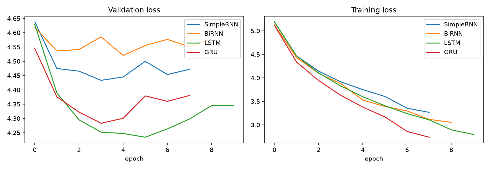
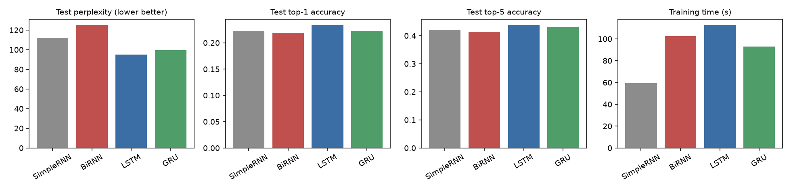
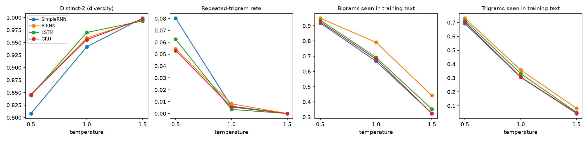

# Autoregressive Word-Level Text Generation: SimpleRNN vs BiRNN vs LSTM vs GRU

Foundations of Generative AI (ICT4403) - Assignment 2

## 1. Problem statement and objective
Build an autoregressive next-word prediction / text-generation system on a textual corpus using four recurrent
architectures (Simple RNN, Bidirectional RNN, LSTM, GRU), train them under identical conditions, compare them
quantitatively (loss, perplexity, top-1/top-5 accuracy, training time) and qualitatively (coherence, diversity,
repetition), and study the effect of sampling temperature (0.5, 1.0, 1.5) on generated text.

## 2. Dataset
- **Alice's Adventures in Wonderland** by Lewis Carroll (public domain), Project Gutenberg eBook #11
- Source: https://www.gutenberg.org/cache/epub/11/pg11.txt (copy stored in `data/alice.txt`)
- Characteristics (after removing the Gutenberg header/footer and chapter headings):
  33,643 tokens (words + punctuation), 2,632 unique tokens, 1,135 of them occur once (hapax legomena).
  Very frequent tokens: `,` `"` `the` `.` `and` `to` `a` `she`. The frequency distribution is Zipfian
  (see `results/dataset_characteristics.png`). The text is dialogue-heavy, which explains the many quote tokens.
- Preprocessing: lowercase, curly quotes normalised, word tokenisation with punctuation kept as separate tokens,
  vocabulary = tokens with frequency >= 2 (1,499 entries incl. `<pad>`, `<unk>`; 3.4 % of tokens map to `<unk>`).
- Input -> target construction: sliding window of 10 tokens (stride 1) -> the next token.
  28,586 train / 2,513 validation / 2,514 test samples from a contiguous 85 / 7.5 / 7.5 % split of the text.

## 3. Models
All models: Embedding(128) -> dropout 0.3 -> recurrent layer (256 units) -> last time-step -> dropout 0.3 -> Linear(vocab).

| Model | Recurrent layer | Parameters |
|---|---|---|
| SimpleRNN | `nn.RNN` (tanh), unidirectional | 675,931 |
| BiRNN | `nn.RNN` (tanh), bidirectional (concatenated 2x256 states) | 1,158,491 |
| LSTM | `nn.LSTM` | 972,379 |
| GRU | `nn.GRU` | 873,563 |

Comparable conditions: same seed (42), data, Adam (lr 2e-3, ReduceLROnPlateau), batch 128, max 25 epochs,
gradient clipping 1.0, early stopping (patience 4 on validation loss, best checkpoint restored), CPU only.
The BiRNN reads only the *given* 10-token context in both directions, so it is still a valid autoregressive model
(no future tokens are used).

## 4. Execution steps and dependencies
```
pip install torch numpy matplotlib nbformat nbclient ipykernel
python autoregressive_textgen.py          # runs everything, writes ./results
# or open autoregressive_textgen.ipynb (already executed, outputs included)
```
Python 3.12+ and PyTorch 2.x (CPU). Total run time about 6-7 minutes on a 16-thread CPU.
Files: `autoregressive_textgen.py` (source), `autoregressive_textgen.ipynb` (same code, executed),
`make_notebook.py`/`run_nb.py` (helpers that build/execute the notebook), `data/alice.txt`, `results/`.

## 5. Results (test set, best-validation checkpoint)

| Model | Best epoch | Test loss | Test perplexity | Top-1 acc | Top-5 acc | Train time (s)* | Train PPL |
|---|---|---|---|---|---|---|---|
| SimpleRNN | 4 | 4.719 | 112.1 | 22.2 % | 42.2 % | 59.6 | 26.4 |
| BiRNN | 5 | 4.826 | 124.8 | 21.8 % | 41.4 % | 102.6 | 17.2 |
| **LSTM** | 6 | **4.553** | **94.9** | **23.3 %** | **43.7 %** | 112.3 | 16.4 |
| GRU | 4 | 4.599 | 99.4 | 22.2 % | 43.0 % | 92.9 | 18.5 |

\*wall-clock for the whole run until early stopping (each model ran a different number of epochs: 8/9/10/8);
seconds per epoch were roughly 7.4 / 11.4 / 11.2 / 11.6, so timings are noisy on a shared CPU. Exact values
are in `results/metrics.json`. Plots: `results/loss_curves.png`, `results/metric_comparison.png`.




## 6. Model comparison and evaluation
- **Quantitative:** LSTM is best on every predictive metric (perplexity 94.9, top-1 23.3 %, top-5 43.7 %), GRU is a
  close second (99.4), SimpleRNN third (112.1) and BiRNN worst (124.8). With only ~28k training windows every model
  overfits quickly (train perplexity 16-26 vs test 95-125); early stopping selected epochs 4-6.
- **Cost:** SimpleRNN is the cheapest per epoch. The BiRNN has the most parameters (1.16 M) and overfits most
  (lowest train PPL among the RNNs, worst test PPL): the backward pass over a 10-word context adds capacity but no
  useful information for left-to-right prediction. The gated models cost more per epoch than SimpleRNN but buy lower
  perplexity.
- **Qualitative** (`results/generated_samples.md`, 50 words per sample; all numbers are means over 10 runs for each of
  3 seeds, see `results/generation.json`). At temperature 0.5, LSTM/GRU/BiRNN produce locally fluent Alice-style
  phrases ("said the mock turtle", "she tried to work", "the little golden key") but wander semantically after ~10
  words; SimpleRNN produces more broken grammar ("she had not off to her", stray `e e`). None of the models keeps
  a topic over 50 words, which is expected for a 10-token window and ~34k tokens of training text.
  Contextual consistency to the seed is weak for all models.
- Measures used for generated text: distinct-1/2 (diversity), repeated-trigram rate (repetition),
  and the share of generated bigrams/trigrams that occur in the training text (a coherence/fluency proxy;
  high = locally plausible, but also closer to copying).

## 7. Sampling-temperature analysis (T = 0.5, 1.0, 1.5; same seeds for all models)

| Model | T | Distinct-2 | Repeated trigrams | Bigrams seen in train | Trigrams seen in train |
|---|---|---|---|---|---|
| SimpleRNN | 0.5 / 1.0 / 1.5 | 0.81 / 0.94 / 1.00 | 8.0 / 0.6 / 0 % | 92 / 67 / 32 % | 69 / 31 / 4 % |
| BiRNN | 0.5 / 1.0 / 1.5 | 0.85 / 0.96 / 1.00 | 5.4 / 0.8 / 0 % | 95 / 79 / 44 % | 73 / 36 / 8 % |
| LSTM | 0.5 / 1.0 / 1.5 | 0.84 / 0.97 / 0.99 | 6.3 / 0.3 / 0 % | 94 / 69 / 35 % | 71 / 33 / 5 % |
| GRU | 0.5 / 1.0 / 1.5 | 0.85 / 0.96 / 1.00 | 5.3 / 0.5 / 0 % | 93 / 68 / 32 % | 70 / 31 / 5 % |



- **T = 0.5 (conservative):** most coherent and grammatical, most repetition (5-8 % repeated trigrams, loops such as
  `" said alice, " ... " said alice`), lowest diversity. Frequent tokens (`,` `"` `the` `she`) dominate.
- **T = 1.0 (balanced):** repetition almost vanishes, diversity high, but local grammar degrades (only ~31-36 % of
  trigrams exist in the book) and sentences mix unrelated fragments.
- **T = 1.5 (flat distribution):** near-maximal diversity (distinct-2 ~1.0, no repetition) but text is essentially a
  random word salad of rare words (only 4-8 % of trigrams seen in training); coherence is lost.
- Trade-off: temperature moves a model along a coherence <-> diversity/repetition frontier; T about 0.7-1.0 would be the
  practical sweet spot (not separately evaluated).
- Caveat: BiRNN's higher "bigrams seen" at T = 1.5 reflects a sharper (more over-confident) output distribution from
  overfitting, not better quality.

## 8. Conclusion
**LSTM is the most effective autoregressive generator for this dataset**: lowest test loss/perplexity (94.9),
highest top-1/top-5 accuracy, and the most fluent samples at T = 0.5-1.0 with low repetition and high diversity at
T = 1.0 (distinct-1 0.77, highest among models at that temperature). GRU is a near-equal, slightly cheaper alternative (perplexity
99.4, ~15 % fewer parameters). SimpleRNN is the cheapest but less accurate, and the bidirectional variant gives no benefit
for left-to-right generation while overfitting the most. Limitations: small corpus, single run per model (one seed),
absolute differences between LSTM/GRU are small and may not be statistically significant, and coherence over
long spans is not achieved by any model; a larger corpus, longer context or Transformer would be needed for that.
